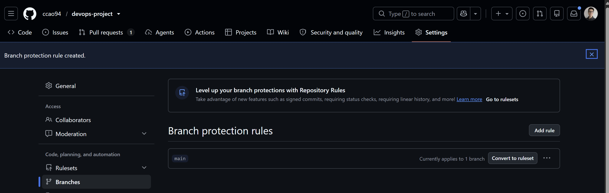
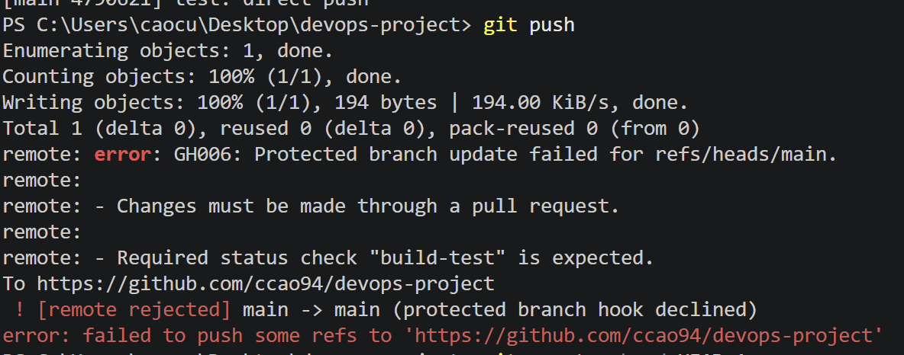
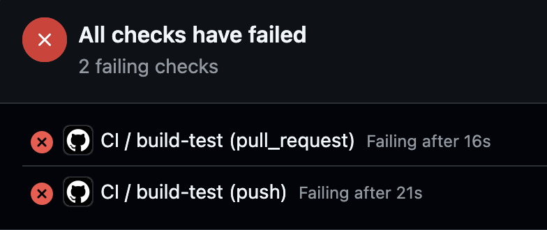
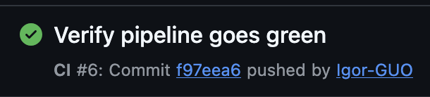
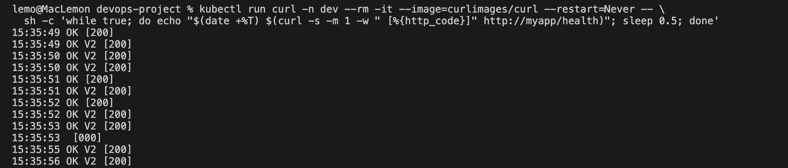
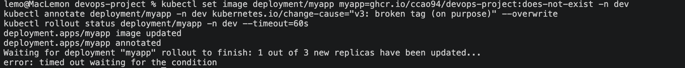
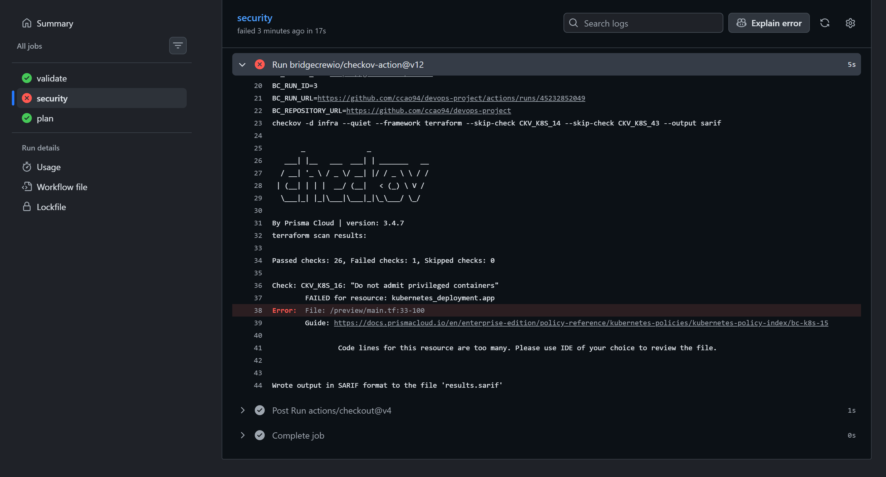
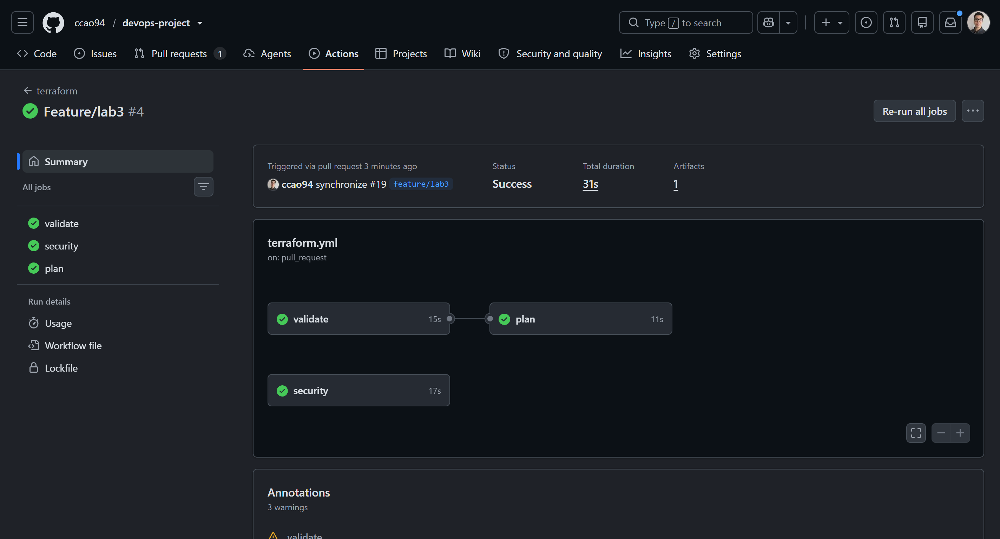

# Lab 1: Git, CI/CD and Docker

## Deliverables

- Repository: https://github.com/ccao94/devops-project
- Branch protection: 
- Direct push rejected: 
- Failing pipeline: 
- Passing pipeline: 
- Published image: https://github.com/ccao94/devops-project/pkgs/container/devops-project 
- Traceability: commit `640f471` (merge of PR #4) → CI run on main → `ghcr.io/ccao94/devops-project:640f471d0a267f320afec784cc7d4c953a2d4311`

## Q1. Why forbid direct pushes to main?

main is what we deploy, so it must always work. A PR forces a review and a green CI before the merge.

## Q2. Image vs container?

An image is a read-only template made of layers. A container is a running instance of it, with a writable layer on top.

## Q3. Image size vs a non-slim base image

| Base image | Disk usage | Content size |
|---|---|---|
| eclipse-temurin:21-jdk (Ubuntu) | 762 MB | 243 MB |
| eclipse-temurin:21-jdk-alpine (ours) | 591 MB | 202 MB |
| eclipse-temurin:21-jre-alpine | 324 MB | 92.3 MB |

Alpine saves about 170 MB. A JRE instead of a JDK saves about 270 MB more, since the JDK ships a compiler and tools we don't need at runtime. The Ubuntu and JRE images were built only to compare sizes.

*AI assistance: AI helped interpret the results.*

## Q4. Why tag with the commit SHA rather than latest?

latest changes at every push, so we can't know which code is running or roll back precisely. A SHA points to exactly one commit.

## Q5. What does "fail fast" mean?

The pipeline stops at the first failing step. If a test fails, no image is built and `publish` (`needs: build-test`) never runs. We have no lint step yet, Checkstyle would be next for Java.

*AI assistance: AI helped write the publish job and this answer.*

---

# Lab 2: Kubernetes, Multi-environment Deployment and Audit

## Deliverables

- Manifests: `k8s/base/`, `k8s/overlays/dev`, `k8s/overlays/staging`, `k8s/overlays/prod`
- `kubectl get all` per namespace: `evidence/lab2/04-get-all-dev.txt`, `evidence/lab2/04-get-all-staging.txt`, `evidence/lab2/04-get-all-prod.txt` (summary: `evidence/lab2/04-deploy-all-envs.txt`)
- Rolling update: `evidence/lab2/05-rollout-v2.txt` 
- Failed rollout and rollback: `evidence/lab2/05-broken-rollout-pods.txt`, `evidence/lab2/05-history-before-undo.txt`, `evidence/lab2/05-history-after-undo.txt` 
- RBAC: `k8s/rbac/viewer.yaml` and `evidence/lab2/06-auth-can-i.txt`

## Q1. What is the role of a namespace? Does it provide strong security isolation by itself?

A namespace splits one cluster into separate spaces, here dev, staging and prod. Names only have to be unique inside a namespace, and RBAC rules or quotas can be set per namespace.

It is not strong isolation. Pods from different namespaces run on the same nodes and can reach each other by default. We would need NetworkPolicies to block that.

## Q2. Why does Kubernetes recreate the deleted pod? Which component is responsible?

The Deployment asks for 3 replicas. When we deleted a pod, the ReplicaSet controller (in the controller manager) saw only 2 and created a new one.

We saw it in our test: the new pod was 111s old, the two others 3m25s (see `evidence/lab2/part2-dev.txt`).

## Q3. What is the difference between a readiness and a liveness probe? What happens to traffic when readiness fails?

The readiness probe ask the question: Is the pod ready to receive traffic ? The liveness probe ask the question: Is the container healthy and alive ?

When readiness fails, the service stop sending requests to this pod. The requests go to another Ready pod. 

## Q4. Is a Kubernetes Secret encrypted by default? How would you improve this?

By default, a Kubernetes Secret is base64-encoded but not encrypted. To improve this, we can encrypt at rest in etcd. 

## Q5. How does this pattern help with hybrid/multi-cloud deployments ?

The pattern keeps one definition of the application and only describes what changes for each target. All environments run the same application, with a fix in the base that reaches every environment, and the differences are easy to review with "kubectl kustomize" and "diff". One pipeline can build one image and deploy it to several clusters, each with its own overlay.

# What would differ between a real on-prem cluster and a cloud cluster?

An on-prem cluster and a cloud cluster would differ in their infrastructure. In the cloud, load balancers, storage, node autoscaling and the control plane are provided and managed by the provider. On-prem, the team must provide them itself. Identity, secrets, registry access, cost and compliance rules can also be different so these differences would go into the overlays.

## Q6. Why did the broken rollout not take down the application?

It does not take down the app beceause it only removes an old pod when a new pod is ready. Kubernetes created one pod with the broken image and waited for it to become ready. This pod never started because the image did not exist, so the rollout stopped there and no old pod was removed.

## Q7. Starting from a pod running in production, how can you find the commit, the reviewer and the pipeline run that produced it?

We first follow the owner references from the pod to its ReplicaSet and then to its Deployment. 

On the Deployment, the annotations give :
- the Git commit
- the pipeline run URL
- the owner and the ticket. 

The image tag, pinned to a commit SHA, and the image digest of the running container also point to the exact build.

With the commit, we can open the merged pull request on GitHub and see who reviewed it. 

With the pipeline URL, we can read the build logs and the test results. This only works if the CI adds these annotations automatically and if the image tag is pinned, never "latest" 

## Q8. Why is manual kubectl edit in production a traceability risk?

A manual "kubectl edit" changes the cluster without a commit, a review or a ticket.

The audit log can show who made the change but never why. The cluster no longer matches Git, so the annotations become wrong and the real state cannot be rebuilt from the repository.

The change is also fragile because the next "kubectl apply" will overwrite it. It skips the tests and checks steps of the CI pipeline and it cannot be rolled back with the "git revert" command. Each changes should go through Git and the pipeline and if there is emergency fi, we should reported it in Git right away.

*AI use: during this lab, AI sometimes helped us debug problems and fix errors.*

---

# Lab 3: Terraform, Environments and Ephemeral Previews

## Deliverables

- Terraform code: `infra/` (quickstart, `modules/webapp`, `envs/dev`, `envs/staging`, `preview`)
- `infra/.gitignore` (state and `.terraform/` excluded) and committed `.terraform.lock.hcl` files
- Drift detection: `evidence/lab3/part3-drift-refresh-only.txt` and `evidence/lab3/part3-drift-plan.txt`
- Two isolated previews, then pr-42 destroyed: `evidence/lab3/part4-two-previews.txt` and `evidence/lab3/part4-after-destroy.txt`
- Terraform CI: failing security scan  and passing run 

## Q1. What did Terraform propose after you deleted the container by hand? What is this situation called?

It proposed to create the container again (1 to add), because it is in the code but no longer in Docker. This is called drift: the real infrastructure no longer matches what Terraform manages.

## Q2. Why should the state file never be committed to Git?

The state can hold sensitive values, like passwords or IPs, in plain text. It also changes at every apply, so two people would overwrite each other's state. It belongs in a remote backend with locking.

## Q3. What are the advantages of one folder and one state per environment compared to workspaces?

Each environment has its own state, so a mistake in dev can't touch staging or prod. You see which environment you work on from the folder name. With workspaces, the code and the backend are shared, and it's easy to apply in the wrong workspace by mistake.

## Q4. Why is a remote backend with locking essential for a team? Which problems does it prevent?

With a remote backend, the whole team uses the same state, not a copy on one laptop. Locking lets only one apply run at a time. Without it, two applies at once can corrupt the state or create the same resources twice, and the state is lost if the laptop is lost.

## Q5. What information in a state file can be sensitive?

Everything Terraform reads or creates: passwords, tokens, keys, connection strings, IPs and resource IDs. Values marked `sensitive` are hidden in the plan output but still stored in plain text in the state.

## Q6. What could go wrong if the preview environment is never destroyed? List three mitigations.

The namespace, pod and service keep running and keep using CPU and memory, which costs money on a real cluster. Old previews pile up, can still be reached, and nobody knows if they can be deleted.

Mitigations: destroy the preview automatically when the PR is closed, add a TTL with labels like our `owner` and `expires`, and run a scheduled job that deletes expired previews.

## Q7. Why run plan on a Pull Request but apply only after merge?

plan changes nothing, so it is safe on any PR and reviewers can read what will change. apply changes real infrastructure, so it must only run once, on reviewed code, from the pipeline. In this lab, a module with a missing block was merged because nothing checked `infra/` on the PR: a validate or plan job would have blocked it.

## Q8. Why should a CI pipeline use short-lived credentials (OIDC) rather than long-lived access keys?

A long-lived key stored in the repo secrets works until someone revokes it: if it leaks, it can be used for months. With OIDC, the pipeline gets a token that lasts a few minutes and only works for this repo. No cloud secret is stored on GitHub.

*AI use: AI helped us write the preview configuration and the Terraform workflow, and debug errors.*