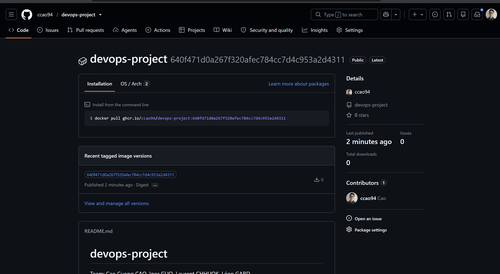

# Lab 1: Git, CI/CD and Docker

## Deliverables

- Repository: https://github.com/ccao94/devops-project
- Branch protection: 
- Direct push rejected: 
- Failing pipeline: 
- Passing pipeline: 
- Published image: https://github.com/ccao94/devops-project/pkgs/container/devops-project 
- Traceability: commit `640f471` (merge of PR #4) → CI run on main → `ghcr.io/ccao94/devops-project:640f471d0a267f320afec784cc7d4c953a2d4311`

## Q1. Why forbid direct pushes to main?

main is what we deploy, so it must always work. A PR forces a review and a green CI before the merge.

## Q2. Image vs container?

An image is a read-only template made of layers. A container is a running instance of it, with a writable layer on top.

## Q3. Image size vs a non-slim base image

| Base image | Disk usage | Content size |
|---|---|---|
| eclipse-temurin:21-jdk (Ubuntu) | 762 MB | 243 MB |
| eclipse-temurin:21-jdk-alpine (ours) | 591 MB | 202 MB |
| eclipse-temurin:21-jre-alpine | 324 MB | 92.3 MB |

Alpine saves about 170 MB. A JRE instead of a JDK saves about 270 MB more, since the JDK ships a compiler and tools we don't need at runtime. The Ubuntu and JRE images were built only to compare sizes.

*AI assistance: AI helped interpret the results.*

## Q4. Why tag with the commit SHA rather than latest?

latest changes at every push, so we can't know which code is running or roll back precisely. A SHA points to exactly one commit.

## Q5. What does "fail fast" mean?

The pipeline stops at the first failing step. If a test fails, no image is built and `publish` (`needs: build-test`) never runs. We have no lint step yet, Checkstyle would be next for Java.

*AI assistance: AI helped write the publish job and this answer.*

---

# Lab 2: Kubernetes, Multi-environment Deployment and Audit

## Q1. What is the role of a namespace? Does it provide strong security isolation by itself?

A namespace splits one cluster into separate spaces, here dev, staging and prod. Names only have to be unique inside a namespace, and RBAC rules or quotas can be set per namespace.

It is not strong isolation. Pods from different namespaces run on the same nodes and can reach each other by default. We would need NetworkPolicies to block that.

## Q2. Why does Kubernetes recreate the deleted pod? Which component is responsible?

The Deployment asks for 3 replicas. When we deleted a pod, the ReplicaSet controller (in the controller manager) saw only 2 and created a new one.

We saw it in our test: the new pod was 111s old, the two others 3m25s (see `evidence/lab2/part2-dev.txt`).

## Q3. What is the difference between a readiness and a liveness probe? What happens to traffic when readiness fails?

Readiness checks if the pod can receive traffic. Liveness checks if the container is still alive, and restarts it if not.

When readiness fails, the Service stops sending requests to this pod. They go to the other ready pods.

## Q4. Is a Kubernetes Secret encrypted by default? How would you improve this?

No. A Secret is only base64-encoded, anyone who can read it can decode it. We can enable encryption at rest in etcd, limit access with RBAC, or use an external secret manager like Vault.

## Q5. How does this pattern help with hybrid/multi-cloud deployments ?

The base describes the app once, and each overlay only holds what changes for its target (here dev, staging, prod for on-prem, cloud A, cloud B). A fix in the base reaches every environment. One pipeline builds one image and deploys it everywhere with the right overlay.

### What would differ between a real on-prem cluster and a cloud cluster?

In the cloud, the provider manages the control plane, load balancers, storage and autoscaling. On-prem, the team runs all of that itself. These differences go into the overlays, for example the Service type (LoadBalancer in the cloud, NodePort on-prem).

*AI assistance: AI helped us structure this answer.*

## Q6. Why did the broken rollout not take down the application?

A rolling update removes an old pod only when a new one is ready. The new pod never started because the image did not exist, so the rollout stopped and the old pods kept serving traffic.

## Q7. Starting from a pod running in production, how can you find the commit, the reviewer and the pipeline run that produced it?

We go up from the pod to its ReplicaSet, then to its Deployment (owner references). The Deployment annotations give the commit SHA, the pipeline run URL, the owner and the ticket.

From the commit, we open the merged PR on GitHub and see who reviewed it. From the run URL, we read the build and test logs. This only works if the CI writes these annotations and the image is pinned to a SHA, never latest.

*AI assistance: AI helped us list the steps of this traceability chain.*

## Q8. Why is manual kubectl edit in production a traceability risk?

kubectl edit changes the cluster with no commit, no review and no ticket. The audit log shows who did it, but not why.

The cluster no longer matches Git: the next kubectl apply overwrites the change, and git revert can't undo it. Every change, even an emergency fix, should go through Git and the pipeline.

---

# Lab 3: Terraform, Environments and Ephemeral Previews

## Q1. What did Terraform propose after you deleted the container by hand? What is this situation called?

It proposed to create the container again (1 to add), because it is in the code but no longer in Docker. This is called drift: the real infrastructure no longer matches what Terraform manages.

## Q2. Why should the state file never be committed to Git?

The state can hold sensitive values, like passwords or IPs, in plain text. It also changes at every apply, so two people would overwrite each other's state. It belongs in a remote backend with locking.

## Q3. What are the advantages of one folder and one state per environment compared to workspaces?

Each environment has its own state, so a mistake in dev can't touch staging or prod. You see which environment you work on from the folder name. With workspaces, the code and the backend are shared, and it's easy to apply in the wrong workspace by mistake.