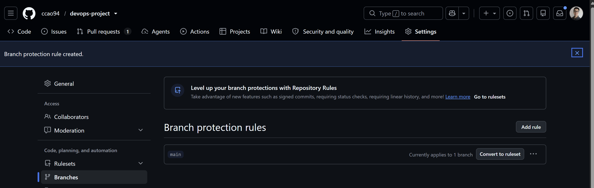
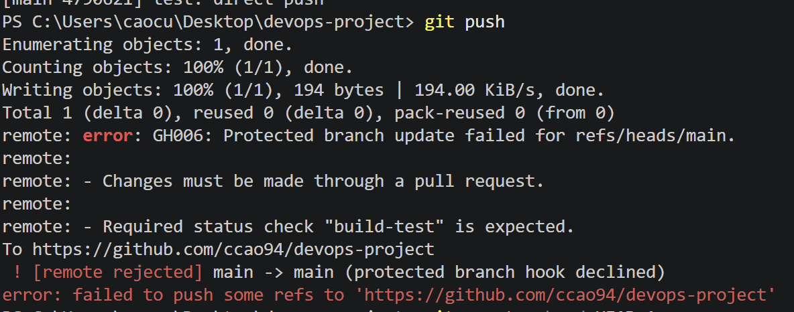
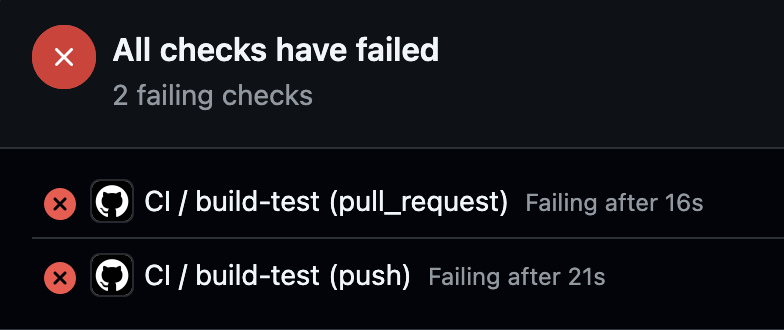
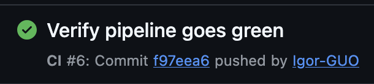
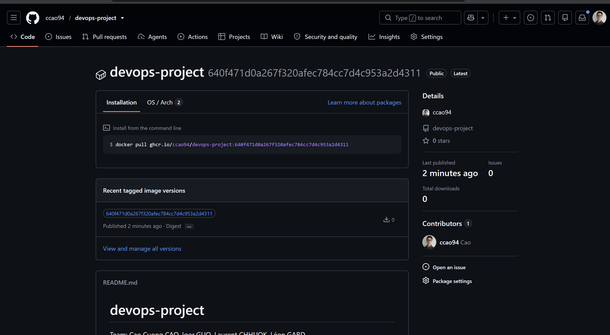

# Lab 1: Git, CI/CD and Docker

## Deliverables

- Repository: https://github.com/ccao94/devops-project
- Branch protection: 
- Direct push rejected: 
- Failing pipeline: 
- Passing pipeline: 
- Published image: https://github.com/ccao94/devops-project/pkgs/container/devops-project 
- Traceability: commit `640f471` (merge of PR #4) → CI run on main → `ghcr.io/ccao94/devops-project:640f471d0a267f320afec784cc7d4c953a2d4311`

## Q1. Why forbid direct pushes to main?

main is what we deploy, so it must always work. A PR forces a review and a green CI before the merge.

## Q2. Image vs container?

An image is a read-only template made of layers. A container is a running instance of it, with a writable layer on top.

## Q3. Image size vs a non-slim base image

| Base image | Disk usage | Content size |
|---|---|---|
| eclipse-temurin:21-jdk (Ubuntu) | 762 MB | 243 MB |
| eclipse-temurin:21-jdk-alpine (ours) | 591 MB | 202 MB |
| eclipse-temurin:21-jre-alpine | 324 MB | 92.3 MB |

Alpine saves about 170 MB. A JRE instead of a JDK saves about 270 MB more, since the JDK ships a compiler and tools we don't need at runtime. The Ubuntu and JRE images were built only to compare sizes.

*AI assistance: AI helped interpret the results. The measurements are ours.*

## Q4. Why tag with the commit SHA rather than latest?

latest changes at every push, so we can't know which code is running or roll back precisely. A SHA points to exactly one commit.

## Q5. What does "fail fast" mean?

The pipeline stops at the first failing step. If a test fails, no image is built and `publish` (`needs: build-test`) never runs. We have no lint step yet, Checkstyle would be next for Java.

*AI assistance: AI helped write the publish job and this answer.*